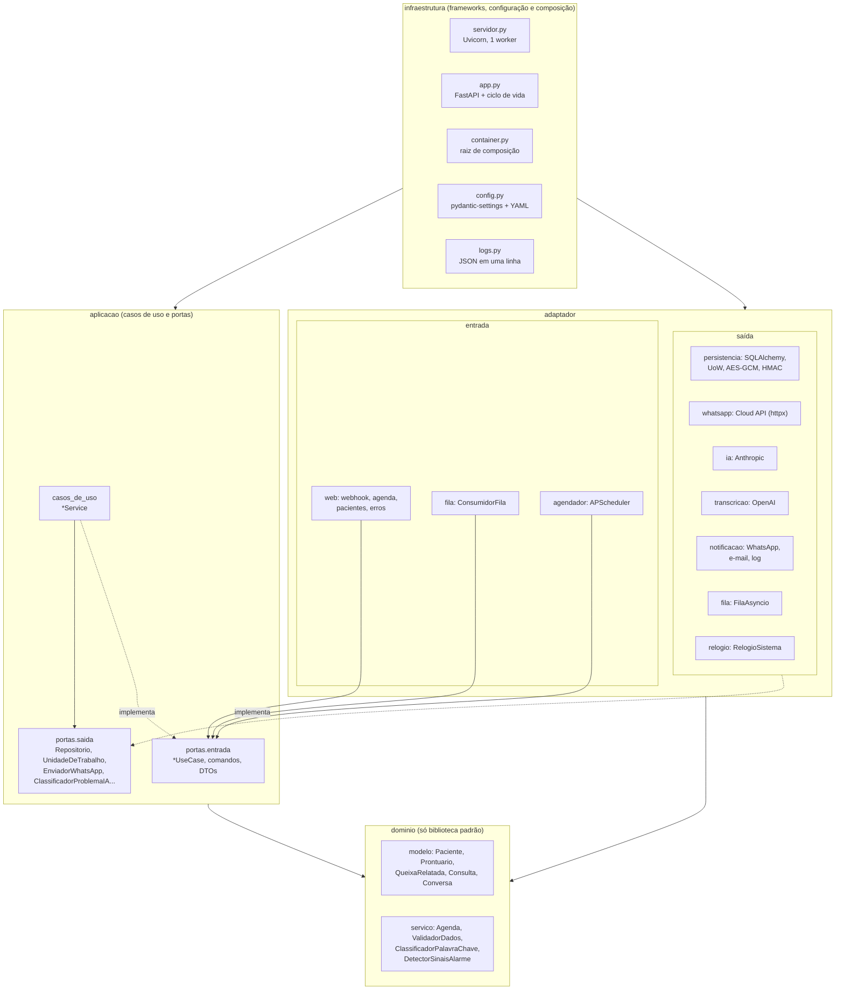
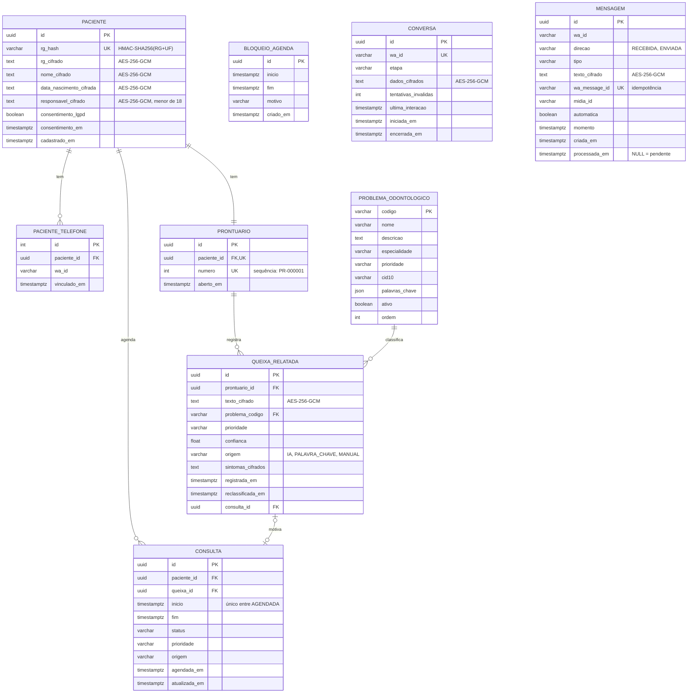
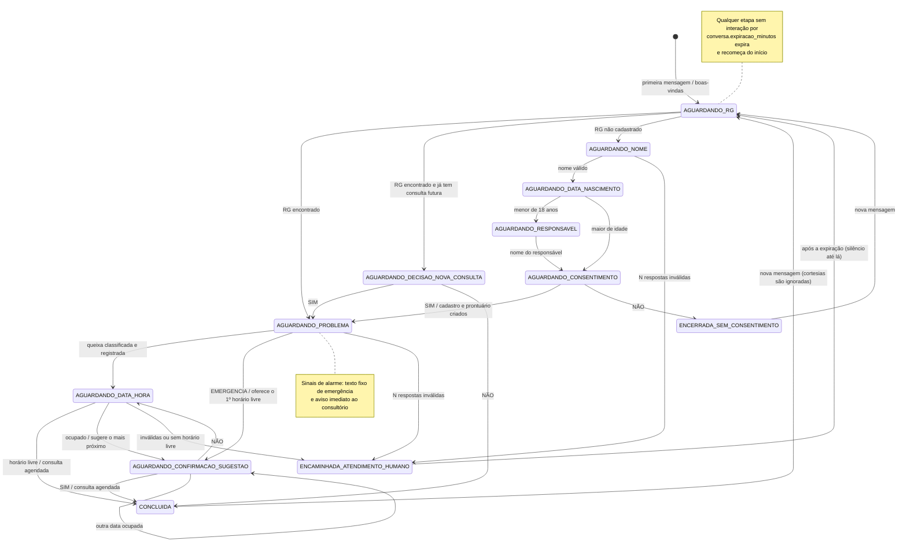
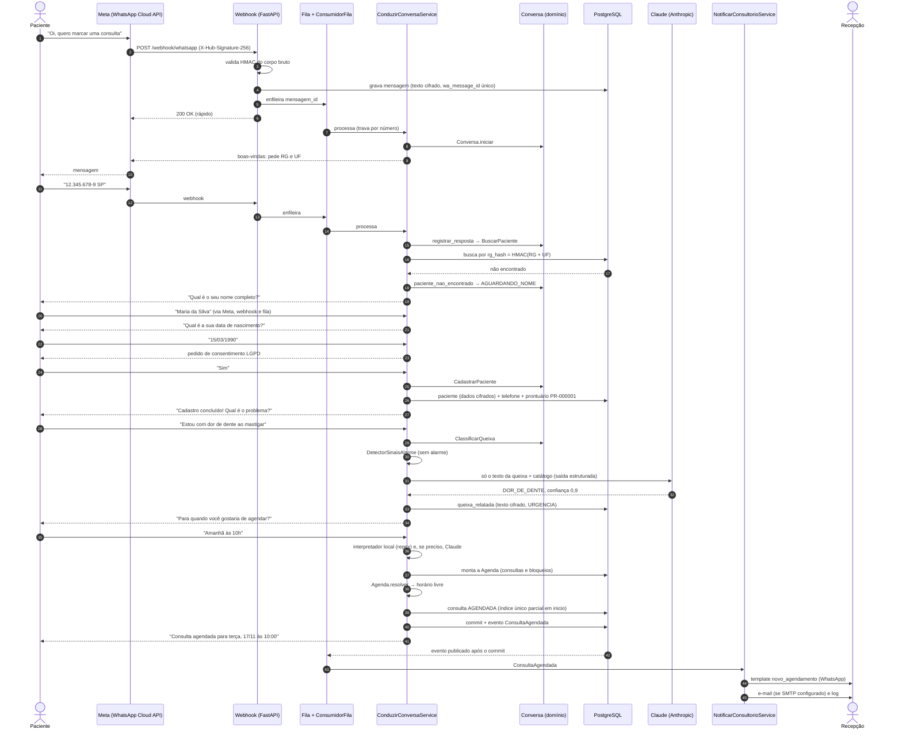
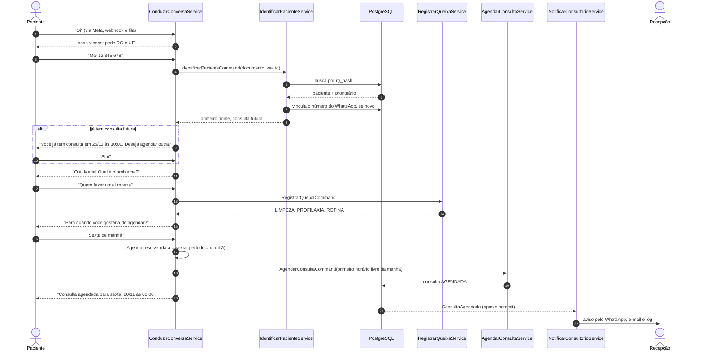
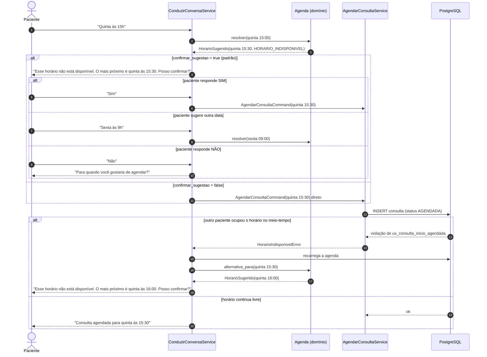
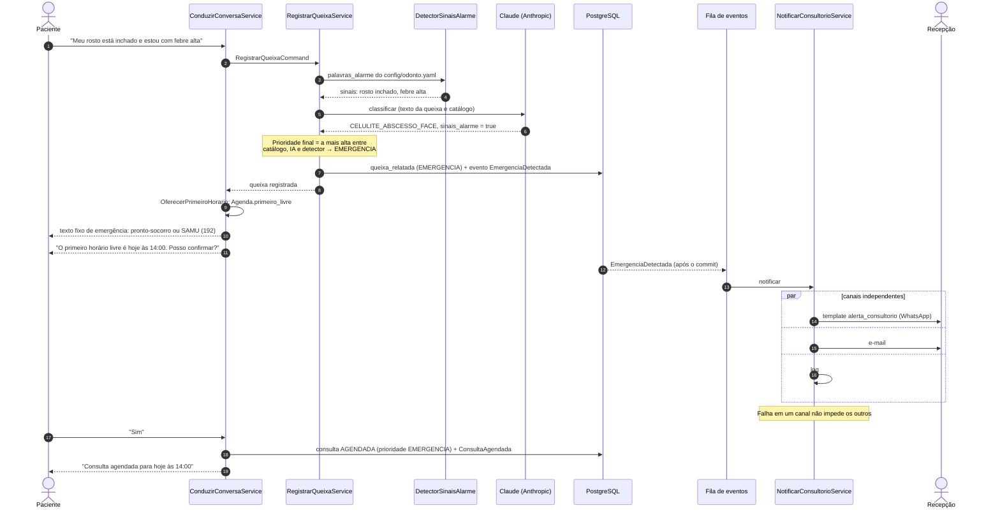
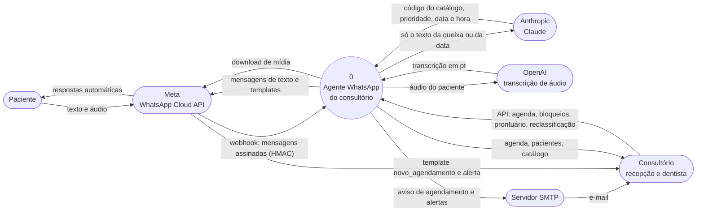
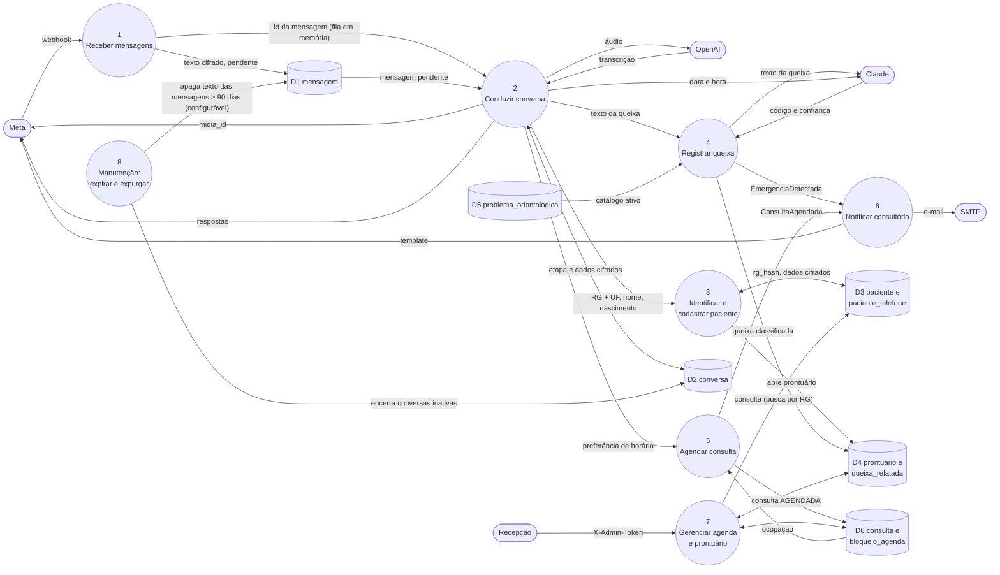
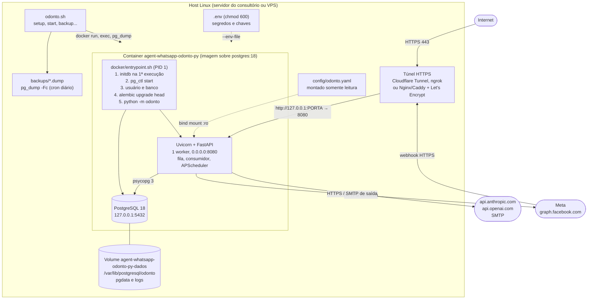

# Diagramas

Fontes em Mermaid na pasta [`fonte/`](fonte/). O GitHub renderiza os blocos abaixo diretamente.
Não há SVG/PNG versionados: o mermaid-cli (`mmdc`) não estava disponível no ambiente de geração. Para gerar localmente:

```bash
npx -p @mermaid-js/mermaid-cli mmdc -i docs/diagramas/fonte/01-arquitetura.mmd -o docs/diagramas/01-arquitetura.svg
```

## Índice

- [1. Arquitetura](fonte/01-arquitetura.mmd)
- [2. Modelo de dados](fonte/02-modelo-dados.mmd)
- [3. Estados da conversa (`EtapaConversa`)](fonte/03-estados-conversa.mmd)
- [4. Sequência: paciente novo](fonte/04-sequencia-paciente-novo.mmd)
- [5. Sequência: paciente existente](fonte/05-sequencia-paciente-existente.mmd)
- [6. Sequência: horário ocupado e conflito de concorrência](fonte/06-sequencia-horario-ocupado.mmd)
- [7. Sequência: queixa com sinais de alarme](fonte/07-sequencia-emergencia.mmd)
- [8. Fluxo de dados nível 0 (contexto)](fonte/08-fluxo-dados-n0.mmd)
- [9. Fluxo de dados nível 1](fonte/09-fluxo-dados-n1.mmd)
- [10. Implantação](fonte/10-implantacao.mmd)

## 1. Arquitetura

Camadas da Clean Architecture. As setas significam "importa" e sempre apontam para dentro; a regra é verificada pelo import-linter (`uv run lint-imports`).



## 2. Modelo de dados

Tabelas do PostgreSQL criadas pelas migrações do Alembic (`migracoes/versions`). Campos marcados como cifrados usam AES-GCM; o RG é localizado pelo `rg_hash` (HMAC-SHA256 de RG + UF).



## 3. Estados da conversa (`EtapaConversa`)

Máquina de estados fixa implementada em `dominio/modelo/conversa.py`. Três respostas inválidas seguidas encaminham para atendimento humano; a inatividade expira a conversa e a próxima mensagem recomeça do RG.



## 4. Sequência: paciente novo



## 5. Sequência: paciente existente



## 6. Sequência: horário ocupado e conflito de concorrência

O índice único parcial `ux_consulta_inicio_agendada` impede duas consultas AGENDADAS no mesmo início; se outra conversa ganhar a corrida, o agente oferece o próximo horário livre.



## 7. Sequência: queixa com sinais de alarme



## 8. Fluxo de dados nível 0 (contexto)

Para a IA vão apenas o texto da queixa ou da data; nome, RG e telefone nunca são enviados.



## 9. Fluxo de dados nível 1

Processos numerados e depósitos de dados (tabelas).



## 10. Implantação

Container único com aplicação e banco no host Linux; o PostgreSQL escuta só em 127.0.0.1 dentro do container.


